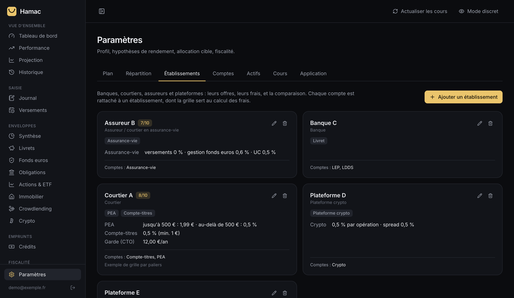
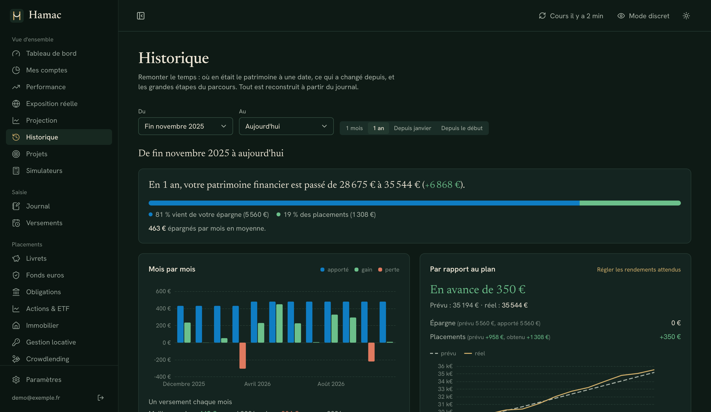

<div align="center">

# Hamac

**Planifier, suivre et piloter son épargne retraite, avec la fiscalité française.**

Livrets réglementés · assurance-vie · PEA · compte-titres · obligations · crypto

[](LICENSE)


</div>

Hamac est un logiciel libre pour construire et suivre un plan d'épargne retraite sur le long terme. On y
note ce qui se passe (versements, achats, intérêts, coupons) ; Hamac calcule le reste : valeur de chaque
enveloppe, plus-values, rendement annualisé, impôts, projection jusqu'au départ et revenu mensuel possible
ensuite. Il est né d'un tableur personnel devenu trop fragile, et en reprend toute la logique en la fiabilisant.

- **Pensé pour la France** : livrets réglementés, règle des quinzaines, assurance-vie (8 ans, abattement),
  PEA (5 ans), prélèvements sociaux, flat tax ou barème, plus-values crypto (art. 150 VH bis).
- **Vos données restent chez vous** : une application web que vous hébergez. Aucun service tiers.
- **Pour vous et vos proches** : chaque compte a son espace isolé dans PostgreSQL ; les cours sont communs
  à l'instance et téléchargés une seule fois.

> Nom provisoire. Hamac est en développement actif : les fonctionnalités ci-dessous sont en place et
> testées, mais aucune version n'est encore publiée.

---

## Sommaire

- [Fonctionnalités](#fonctionnalités)
- [Captures](#captures)
- [Installation](#installation)
- [Sources de données et vie privée](#sources-de-données-et-vie-privée)
- [Avertissement](#avertissement)
- [Développement](#développement)
- [Contribuer](#contribuer)
- [Feuille de route](#feuille-de-route)
- [Licence](#licence)

---

## Fonctionnalités

### Suivre son patrimoine

- **Journal unique** de toutes les opérations : apports, versements, retraits, achats, ventes, intérêts,
  coupons, dividendes, transferts entre comptes, frais, corrections.
- **Versements mensuels programmés** par compte, avec les mois manqués : chaque mois écoulé est compté.
- **Livrets** (LEP, LDDS, Livret A…) : historique des taux, intérêts de l'année calculés par quinzaines,
  plancher et plafond du plan, plafonds légaux.
- **Assurance-vie** : fonds euros, taux servis, rapprochement avec le relevé de l'assureur, clause
  bénéficiaire, garantie FGAP.
- **Obligations** (OAT et entreprises) détenues jusqu'à l'échéance : coupon couru, valeur amortie,
  rendement actuariel, remboursement automatique à l'échéance, échelle prévue et réalisée.
- **Actions et ETF** (PEA et comptes-titres) : prix de revient, cours en direct, écart à la répartition
  cible, achat conseillé du mois.
- **Crypto** : positions, plus-values de chaque cession et impôt de l'année.
- **Historique** reconstruit mois par mois depuis le journal : corriger une opération passée corrige
  tout l'historique.

### Calculer et anticiper

- **Allocation cible** fonds euros / obligations / actions, avec une baisse progressive de la part
  actions à l'approche de la retraite.
- **Performance** : rendement annualisé (TRI) par enveloppe, comparé aux hypothèses du plan.
- **Impôts** : ce que coûterait un retrait aujourd'hui, rendements nets comparés, impôts de chaque année
  (acompte, régularisation, prélèvements sociaux).
- **Projection** année par année jusqu'au départ, avec tous les versements programmés, les frais des
  établissements et les grosses dépenses prévues, puis la phase de retraits jusqu'à l'âge horizon.
- **Fourchette de résultats** selon les marchés (simulation de Monte-Carlo) et simulateur « et si »
  (versement en plus, âge de départ, rendement, inflation).

### Contrôler

- **Alertes** : livrets hors fourchette, répartition qui s'écarte de sa cible, espèces à investir,
  échéance proche, cours manquants, ordres trop chers, intérêts de l'année à saisir, anniversaires
  fiscaux, clause bénéficiaire à rédiger…
- **Établissements** : chaque banque, courtier ou assureur avec ses grilles de frais (courtage par
  paliers, droits de garde, frais sur versements et de gestion), et un comparatif calculé.

### Saisir simplement

- Formulaires guidés : frais calculés d'après la grille de l'établissement, titres créés au moment de
  l'achat, obligations saisies par leur coupon et leur échéance.
- **Recherche de titres** par nom ou par ISIN (actions, ETF, obligations d'État et d'entreprise, crypto).
- **Crowdlending** : suivi des prêts projet par projet, plateforme par plateforme.
- **Import des relevés** de banque ou de courtier en CSV, OFX ou QIF (aperçu avant import, doublons repérés) et export.
- **Sauvegarde complète** exportable et restaurable, pour passer d'une instance à une autre.
- Tableaux triables, mode discret qui masque les montants, interface sombre.

## Captures

<table>
  <tr>
    <td></td>
    <td></td>
  </tr>
  <tr>
    <td align="center">Projection et simulateur « et si »</td>
    <td align="center">Échelle d'obligations</td>
  </tr>
  <tr>
    <td></td>
    <td></td>
  </tr>
  <tr>
    <td align="center">Établissements et frais</td>
    <td align="center">Journal des opérations</td>
  </tr>
</table>

<p align="center"><br>Historique reconstruit depuis le journal</p>

Les captures utilisent le jeu de données fictif fourni avec Hamac (`HAMAC_DEMO=1`).

## Installation

Il faut [Docker](https://www.docker.com) avec Docker Compose, rien d'autre.

```bash
git clone <adresse-du-dépôt> hamac
cd hamac
docker compose up -d --build
```

Ouvrez <http://localhost:8080> et créez le premier compte, avec le code d'installation à usage unique affiché
par `docker compose logs hamac`. Ce compte devient administrateur de l'instance et règle les sources de cours.
Les suivants s'inscrivent ensuite avec un code d'invitation.

```bash
docker compose exec hamac node cli.mjs invite              # code d'invitation à transmettre
docker compose exec hamac node cli.mjs users               # liste des comptes
docker compose exec hamac node cli.mjs password <e-mail>   # changer un mot de passe
```

Par défaut, Hamac n'écoute que sur la machine qui l'héberge. Hors de cette machine, il refuse les connexions
en HTTP simple.

**Mise en production, en HTTPS** : faites pointer un nom de domaine vers le serveur, ouvrez les ports 80 et 443,
puis décommentez `COMPOSE_FILE` et `HAMAC_DOMAIN` dans `.env` (`cp .env.example .env`) et lancez
`docker compose up -d --build`. [Caddy](https://caddyserver.com) obtient et renouvelle le certificat, redirige
le HTTP vers HTTPS, et Hamac n'est plus joignable que par lui.

Toutes les variables se règlent dans ce fichier `.env`, facultatif, exclu de git et de l'image Docker.

| Variable | Défaut | Rôle |
|---|---|---|
| `HAMAC_DOMAIN` | | Nom de domaine servi par Caddy, avec `COMPOSE_FILE` |
| `HAMAC_BIND` | `127.0.0.1` | `0.0.0.0` pour écouter sur le réseau, derrière votre propre reverse proxy HTTPS |
| `HAMAC_TRUST_PROXY` | `0` | `1` derrière un reverse proxy : HTTPS détecté, vraie adresse des visiteurs. Réglé par le Caddy fourni |
| `HAMAC_SECURE` | `0` | `1` pour considérer toute requête comme HTTPS. Réglé par le Caddy fourni |
| `HAMAC_ALLOW_HTTP` | `0` | `1` pour autoriser le HTTP simple hors de la machine (déconseillé) |
| `HAMAC_SIGNUP` | `invite` | `invite`, `open` ou `closed` |
| `HAMAC_DB_PASSWORD` | `hamac` | Mot de passe PostgreSQL, lettres et chiffres ; la base n'est jamais exposée hors de Docker |
| `HAMAC_PORT` | `8080` | Port publié sur la machine |
| `HAMAC_SESSION_DAYS` | `30` | Durée d'une session avant de devoir se reconnecter |
| `HAMAC_PRICES` | `1` | `0` pour ne pas actualiser les cours automatiquement |
| `HAMAC_REFRESH_MINUTES` | `30` | Minutes entre deux actualisations des cours, 10 au minimum ; le quota de Twelve Data peut ralentir ce rythme |
| `HAMAC_TWELVEDATA_KEY` | vide | Clé [Twelve Data](https://twelvedata.com), facultative. C'est le seul endroit où elle se règle : ni en base, ni dans l'interface |
| `HAMAC_TWELVEDATA_DAILY_LIMIT` | `800` | Requêtes par jour de votre offre Twelve Data |

Sécurité : sessions par cookie `HttpOnly`, `SameSite=Strict` et `Secure` en HTTPS, HSTS, en-tête anti-CSRF, limitation des tentatives de connexion, en-têtes CSP et anti-iframe. Chaque compte a son propre
schéma et son propre rôle PostgreSQL : il ne peut lire ni les données des autres ni les comptes de
l'instance.

Avant chaque migration de la base, une copie de chaque compte est écrite dans le volume `hamac-data`, en JSON
compressé. Chaque personne peut exporter et restaurer ses données dans Paramètres › Application. Ce volume est
sur la même machine que la base : pour vous protéger d'une panne de disque, copiez aussi la base ailleurs
(par exemple `docker compose exec -T db pg_dump -U hamac hamac > hamac.sql`).

**Reprendre une ancienne base de l'application de bureau** : avec Node.js 22.13 ou plus récent,
`node apps/server/scripts/export-desktop.mjs` crée `hamac-export-bureau.json`, à restaurer dans
Paramètres › Application. Le dernier état du bureau reste disponible au tag `derniere-version-desktop`.

## Sources de données et vie privée

Hamac ne collecte rien et n'envoie vos données nulle part. Les seules requêtes vers l'extérieur servent
à récupérer des cours et à identifier des titres, sans clé d'API par défaut :

| Source | Utilisation |
|---|---|
| [justETF](https://www.justetf.com) | Cours et historique des ETF, par ISIN |
| [CoinGecko](https://www.coingecko.com) | Cours et historique des cryptos |
| [OpenFIGI](https://www.openfigi.com) | Recherche et identification des titres (obligations comprises) |
| Yahoo Finance | Cours des actions, au mieux : l'accès peut être refusé selon le réseau |

Ces requêtes révèlent aux fournisseurs les identifiants des titres que vous suivez, pas leurs montants.
Les obligations n'ont besoin d'aucun cours (valeur calculée) et tout cours peut être saisi à la main.
Les accès non officiels peuvent cesser de fonctionner sans préavis ; respectez les conditions
d'utilisation de chaque fournisseur.

## Avertissement

Hamac est un outil de suivi et de calcul, **pas un conseil en investissement**. Les projections reposent
sur des hypothèses que vous choisissez et ne garantissent aucun résultat. Les règles fiscales et les taux
par défaut sont ceux de 2026 et doivent être vérifiés chaque année (avis d'imposition, déclaration
préremplie, impots.gouv.fr). En cas de doute sur votre situation, consultez un professionnel.

## Développement

Hamac est écrit entièrement en TypeScript, en monorepo pnpm :

```
apps/
  server/     serveur web (Hono) : comptes, tenants, interface
packages/
  core/       calculs métier purs : fiscalité, frais, obligations, projection, alertes (sans dépendance d'E/S)
  api/        contrat typé (zod) entre l'interface et le backend
  backend/    PostgreSQL + Drizzle, tenants isolés, migrations embarquées, base de cours commune
  ui/         interface React
```

L'interface ne connaît que le contrat `@hamac/api`, qu'elle appelle en HTTP. Les calculs vivent dans
`@hamac/core` et tournent dans le navigateur, ce qui rend les simulations instantanées.

```bash
pnpm dev:db         # PostgreSQL dans Docker, exposé en local (à lancer une fois)
pnpm dev            # serveur sur :8080 et interface avec rechargement à chaud sur http://localhost:5173
pnpm test           # tests (Vitest), sur un PostgreSQL en mémoire (PGlite) : Docker non requis
pnpm typecheck      # vérification des types de tous les paquets
pnpm build          # interface et serveur, dans apps/server/dist
HAMAC_LIVE=1 pnpm test   # inclut les tests sur les vraies sources de cours
```

**Modifier le schéma de la base** : éditer `packages/backend/src/db/schema.ts` puis lancer
`pnpm --filter @hamac/backend db:generate`, qui crée la migration SQL et l'embarque dans le code. Elle
s'applique à chaque tenant à sa prochaine ouverture. Une reprise de données s'écrit à la main dans le
fichier SQL généré.

La documentation du modèle de données est dans
[`docs/architecture/modele-de-donnees.md`](docs/architecture/modele-de-donnees.md).

## Contribuer

Les contributions sont bienvenues : signalements, idées, corrections, nouvelles fonctionnalités.

- **Un bug, une idée** : ouvrez une issue en décrivant ce que vous attendiez et ce qui s'est passé. Pour
  un calcul, un exemple chiffré aide beaucoup. Ne joignez jamais vos vraies données : reproduisez le cas
  avec le jeu de démonstration ou des montants fictifs.
- **Une modification** : ouvrez une pull request avec des tests. Toute règle de calcul ou de fiscalité
  va dans `@hamac/core`, accompagnée de tests chiffrés, et cite sa source (texte de loi, BOFiP, site
  officiel).
- **Langue** : l'interface, les messages et la documentation sont en français.
- **Avant d'envoyer** : `pnpm typecheck` et `pnpm test` doivent passer.

## Feuille de route

- Première version publiée, avec installateurs signés et mises à jour automatiques
- Modèles d'établissements pré-remplis (grilles de frais datées, à vérifier)
- PEA-PME, PER et plans d'épargne salariale
- Formats d'import CSV prêts à l'emploi pour les principaux courtiers
- Mémorisation des tris et des filtres
- Source de cours officielle optionnelle pour les actions (avec clé d'API)

## Licence

Hamac est distribué sous licence [GNU AGPL v3](LICENSE). Vous pouvez l'utiliser, l'étudier, le modifier
et le redistribuer librement. Toute version modifiée mise à disposition d'autres personnes, y compris
via un serveur, doit publier son code source sous la même licence.
