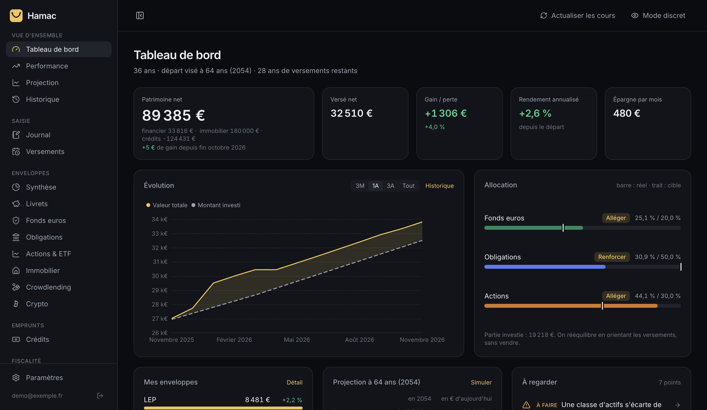
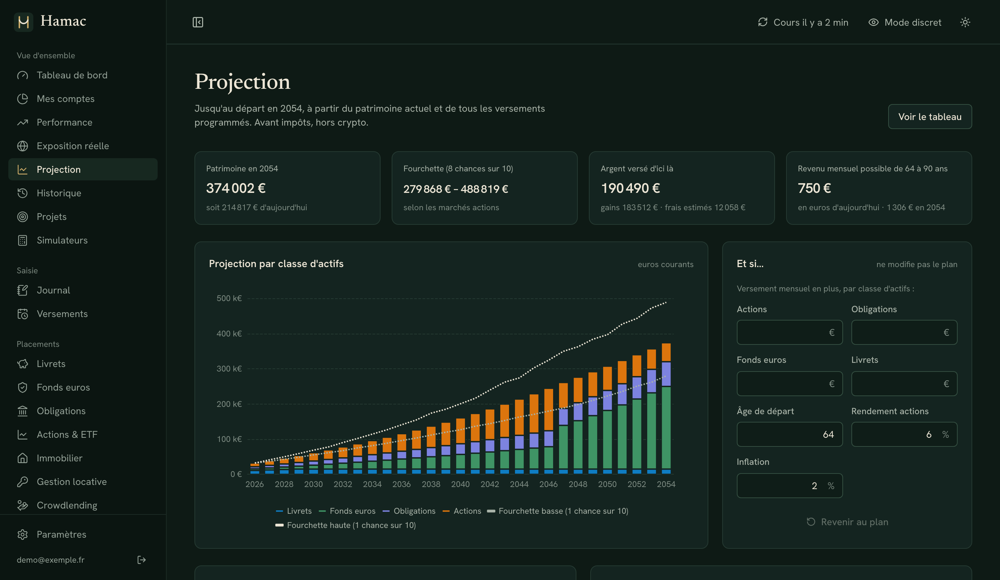
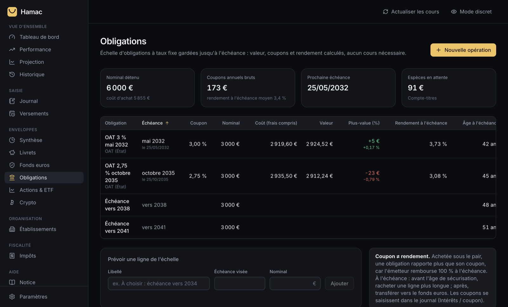

<div align="center">

# Hamac

**Planifier, suivre et piloter son épargne retraite, avec la fiscalité française.**

Livrets réglementés · assurance-vie · PEA · compte-titres · obligations · crypto

[](LICENSE)




</div>

Hamac est un logiciel libre pour construire et suivre un plan d'épargne retraite sur le long terme. On y
note ce qui se passe (versements, achats, intérêts, coupons) ; Hamac calcule le reste : valeur de chaque
enveloppe, plus-values, rendement annualisé, impôts, projection jusqu'au départ et revenu mensuel possible
ensuite. Il est né d'un tableur personnel devenu trop fragile, et en reprend toute la logique en la fiabilisant.

- **Pensé pour la France** : livrets réglementés, règle des quinzaines, assurance-vie (8 ans, abattement),
  PEA (5 ans), prélèvements sociaux, flat tax ou barème, plus-values crypto (art. 150 VH bis).
- **Vos données restent chez vous** : application de bureau avec un simple fichier SQLite local,
  sauvegardé automatiquement chaque jour. Pas de compte, pas de cloud.
- **Libre et auto-hébergeable** : une instance web pour vos proches, chacun dans sa propre base.

> Nom provisoire. Hamac est en développement actif : les fonctionnalités ci-dessous sont en place et
> testées, mais aucune version n'est encore publiée.

---

## Sommaire

- [Fonctionnalités](#fonctionnalités)
- [Captures](#captures)
- [Installation](#installation)
- [Héberger une instance web](#héberger-une-instance-web)
- [Sources de données et vie privée](#sources-de-données-et-vie-privée)
- [Avertissement](#avertissement)
- [Développement](#développement)
- [Contribuer](#contribuer)
- [Feuille de route](#feuille-de-route)
- [Licence](#licence)

---

## Fonctionnalités

### Suivre son patrimoine

- **Journal unique** de toutes les opérations : apports, versements, retraits, achats, ventes, intérêts,
  coupons, dividendes, transferts entre comptes, frais, corrections.
- **Versements mensuels programmés** par compte, avec les mois manqués : chaque mois écoulé est compté.
- **Livrets** (LEP, LDDS, Livret A…) : historique des taux, intérêts de l'année calculés par quinzaines,
  plancher et plafond du plan, plafonds légaux.
- **Assurance-vie** : fonds euros, taux servis, rapprochement avec le relevé de l'assureur, clause
  bénéficiaire, garantie FGAP.
- **Obligations** (OAT et entreprises) détenues jusqu'à l'échéance : coupon couru, valeur amortie,
  rendement actuariel, remboursement automatique à l'échéance, échelle prévue et réalisée.
- **Actions et ETF** (PEA et comptes-titres) : prix de revient, cours en direct, écart à la répartition
  cible, achat conseillé du mois.
- **Crypto** : positions, plus-values de chaque cession et impôt de l'année.
- **Historique** reconstruit mois par mois depuis le journal : corriger une opération passée corrige
  tout l'historique.

### Calculer et anticiper

- **Allocation cible** fonds euros / obligations / actions, avec une baisse progressive de la part
  actions à l'approche de la retraite.
- **Performance** : rendement annualisé (TRI) par enveloppe, comparé aux hypothèses du plan.
- **Impôts** : ce que coûterait un retrait aujourd'hui, rendements nets comparés, impôts de chaque année
  (acompte, régularisation, prélèvements sociaux).
- **Projection** année par année jusqu'au départ, avec tous les versements programmés, les frais des
  établissements et les grosses dépenses prévues, puis la phase de retraits jusqu'à l'âge horizon.
- **Fourchette de résultats** selon les marchés (simulation de Monte-Carlo) et simulateur « et si »
  (versement en plus, âge de départ, rendement, inflation).

### Contrôler

- **Alertes** : livrets hors fourchette, répartition qui s'écarte de sa cible, espèces à investir,
  échéance proche, cours manquants, ordres trop chers, intérêts de l'année à saisir, anniversaires
  fiscaux, clause bénéficiaire à rédiger…
- **Établissements** : chaque banque, courtier ou assureur avec ses grilles de frais (courtage par
  paliers, droits de garde, frais sur versements et de gestion), et un comparatif calculé.

### Saisir simplement

- Formulaires guidés : frais calculés d'après la grille de l'établissement, titres créés au moment de
  l'achat, obligations saisies par leur coupon et leur échéance.
- **Recherche de titres** par nom ou par ISIN (actions, ETF, obligations d'État et d'entreprise, crypto).
- **Import des relevés** de banque ou de courtier en CSV, OFX ou QIF (aperçu avant import, doublons repérés) et export.
- **Sauvegarde complète** exportable et restaurable, pour passer du bureau au web et inversement.
- Tableaux triables, mode discret qui masque les montants, interface sombre.

## Captures

<table>
  <tr>
    <td></td>
    <td></td>
  </tr>
  <tr>
    <td align="center">Projection et simulateur « et si »</td>
    <td align="center">Échelle d'obligations</td>
  </tr>
  <tr>
    <td></td>
    <td></td>
  </tr>
  <tr>
    <td align="center">Établissements et frais</td>
    <td align="center">Journal des opérations</td>
  </tr>
</table>

<p align="center"><br>Historique reconstruit depuis le journal</p>

Les captures utilisent le jeu de données fictif fourni avec Hamac (`HAMAC_DEMO=1`).

## Installation

Aucun installateur n'est encore publié. En attendant la première version, Hamac se lance depuis les
sources.

**Prérequis** : [Node.js](https://nodejs.org) 22.13 ou plus récent (24 recommandé) et
[pnpm](https://pnpm.io) 9.

```bash
git clone <adresse-du-dépôt> hamac
cd hamac
pnpm install
pnpm dev                 # lance l'application de bureau
```

Pour découvrir l'application sans saisir vos données, démarrez-la avec le jeu de démonstration fictif,
dans un dossier séparé de vos vraies données :

```bash
HAMAC_DEMO=1 HAMAC_DATA_DIR=/tmp/hamac-demo pnpm dev
```

Pour produire l'installateur de votre système (`.dmg`, `.exe` ou `.AppImage`/`.deb`) :

```bash
pnpm dist                # résultat dans apps/desktop/release
```

Les installateurs ne sont pas encore signés : au premier lancement, macOS et Windows affichent un
avertissement qu'il faut confirmer.

## Héberger une instance web

Hamac peut tourner sur un serveur pour vous et quelques proches. Chaque personne a sa propre base, isolée
des autres.

```bash
docker compose up -d                              # http://localhost:8080
docker compose exec hamac node cli.mjs invite     # code d'invitation à transmettre
docker compose exec hamac node cli.mjs users      # liste des comptes
docker compose exec hamac node cli.mjs password <e-mail>   # changer un mot de passe
```

Le premier compte créé devient celui de l'administrateur. Ensuite, l'inscription demande un code
d'invitation (par défaut), est libre ou fermée. Placez un reverse proxy HTTPS (Caddy, Traefik, nginx)
devant le serveur et activez `HAMAC_SECURE=1`.

| Variable | Défaut | Rôle |
|---|---|---|
| `HAMAC_DATA_DIR` | `/data` | Base des comptes + une base SQLite par utilisateur |
| `HAMAC_PORT` | `8080` | Port d'écoute |
| `HAMAC_SIGNUP` | `invite` | `invite`, `open` ou `closed` |
| `HAMAC_SECURE` | `0` | `1` derrière HTTPS (cookies sécurisés) |
| `HAMAC_PRICES` | `1` | `0` pour ne pas actualiser les cours automatiquement |

Sécurité : mots de passe hachés (scrypt), sessions par cookie `HttpOnly` et `SameSite=Strict`, en-tête
anti-CSRF, limitation des tentatives de connexion, en-têtes CSP et anti-iframe, chemins du serveur non
exposés.

## Sources de données et vie privée

Hamac ne collecte rien et n'envoie vos données nulle part. Les seules requêtes vers l'extérieur servent
à récupérer des cours et à identifier des titres, sans clé d'API :

| Source | Utilisation |
|---|---|
| [justETF](https://www.justetf.com) | Cours et historique des ETF, par ISIN |
| [CoinGecko](https://www.coingecko.com) | Cours et historique des cryptos |
| [OpenFIGI](https://www.openfigi.com) | Recherche et identification des titres (obligations comprises) |
| Yahoo Finance | Cours des actions, au mieux : l'accès peut être refusé selon le réseau |

Ces requêtes révèlent aux fournisseurs les identifiants des titres que vous suivez, pas leurs montants.
Les obligations n'ont besoin d'aucun cours (valeur calculée) et tout cours peut être saisi à la main.
Les accès non officiels peuvent cesser de fonctionner sans préavis ; respectez les conditions
d'utilisation de chaque fournisseur.

## Avertissement

Hamac est un outil de suivi et de calcul, **pas un conseil en investissement**. Les projections reposent
sur des hypothèses que vous choisissez et ne garantissent aucun résultat. Les règles fiscales et les taux
par défaut sont ceux de 2026 et doivent être vérifiés chaque année (avis d'imposition, déclaration
préremplie, impots.gouv.fr). En cas de doute sur votre situation, consultez un professionnel.

## Développement

Hamac est écrit entièrement en TypeScript, en monorepo pnpm :

```
apps/
  desktop/    application de bureau (Electron) : fenêtre, pont IPC, base locale
  server/     serveur web auto-hébergé (Hono) : comptes, une base SQLite par utilisateur
packages/
  core/       calculs métier purs : fiscalité, frais, obligations, projection, alertes (sans dépendance d'E/S)
  api/        contrat typé (zod) entre l'interface et le backend
  backend/    SQLite intégré à Node (node:sqlite) + Drizzle, migrations embarquées, sources de cours
  ui/         interface React, identique sur le bureau et sur le web
```

L'interface ne connaît que le contrat `@hamac/api` : elle l'appelle par IPC sur le bureau et par HTTP sur
le web. Les calculs vivent dans `@hamac/core` et tournent dans l'interface, ce qui rend les simulations
instantanées. SQLite est celui intégré à Node : aucun module natif à compiler.

```bash
pnpm dev            # interface avec rechargement à chaud + Electron (backend redémarré à chaque modification)
pnpm test           # tests (Vitest)
pnpm typecheck      # vérification des types de tous les paquets
pnpm build          # construction de l'interface et du processus principal
pnpm dist           # installateur pour le système courant
pnpm server:build   # serveur web (interface incluse) dans apps/server/dist
HAMAC_LIVE=1 pnpm test   # inclut les tests sur les vraies sources de cours
```

**Modifier le schéma de la base** : éditer `packages/backend/src/db/schema.ts` puis lancer
`pnpm --filter @hamac/backend db:generate`, qui crée la migration SQL et l'embarque dans le code. Une
reprise de données s'écrit à la main dans le fichier SQL généré.

| Variable (bureau) | Effet |
|---|---|
| `HAMAC_DATA_DIR` | Dossier de données isolé (ne touche pas à vos vraies données) |
| `HAMAC_DEMO=1` | Remplit une base vide avec le jeu de données fictif |
| `HAMAC_SMOKE_SHOT` | Capture la fenêtre en PNG à ce chemin puis quitte (test de fumée) |
| `HAMAC_SMOKE_ROUTE` | Page affichée avant la capture, par exemple `/obligations` |
| `HAMAC_SMOKE_SCROLL=bas` | Capture le bas de la page |

La documentation du modèle de données est dans
[`docs/architecture/modele-de-donnees.md`](docs/architecture/modele-de-donnees.md).

## Contribuer

Les contributions sont bienvenues : signalements, idées, corrections, nouvelles fonctionnalités.

- **Un bug, une idée** : ouvrez une issue en décrivant ce que vous attendiez et ce qui s'est passé. Pour
  un calcul, un exemple chiffré aide beaucoup. Ne joignez jamais vos vraies données : reproduisez le cas
  avec le jeu de démonstration ou des montants fictifs.
- **Une modification** : ouvrez une pull request avec des tests. Toute règle de calcul ou de fiscalité
  va dans `@hamac/core`, accompagnée de tests chiffrés, et cite sa source (texte de loi, BOFiP, site
  officiel).
- **Langue** : l'interface, les messages et la documentation sont en français.
- **Avant d'envoyer** : `pnpm typecheck` et `pnpm test` doivent passer.

## Feuille de route

- Première version publiée, avec installateurs signés et mises à jour automatiques
- Modèles d'établissements pré-remplis (grilles de frais datées, à vérifier)
- PEA-PME, PER et plans d'épargne salariale
- Formats d'import CSV prêts à l'emploi pour les principaux courtiers
- Mémorisation des tris et des filtres
- Source de cours officielle optionnelle pour les actions (avec clé d'API)

## Licence

Hamac est distribué sous licence [GNU AGPL v3](LICENSE). Vous pouvez l'utiliser, l'étudier, le modifier
et le redistribuer librement. Toute version modifiée mise à disposition d'autres personnes, y compris
via un serveur, doit publier son code source sous la même licence.
