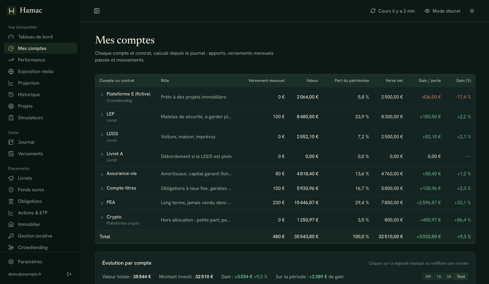
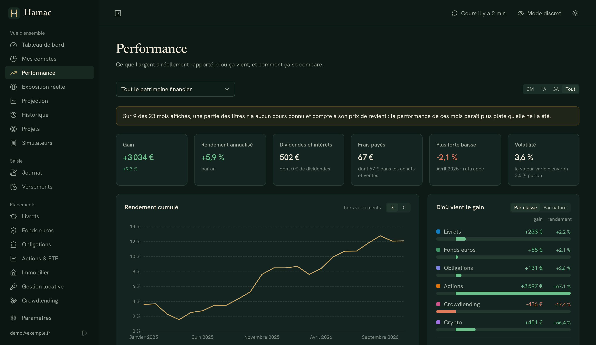
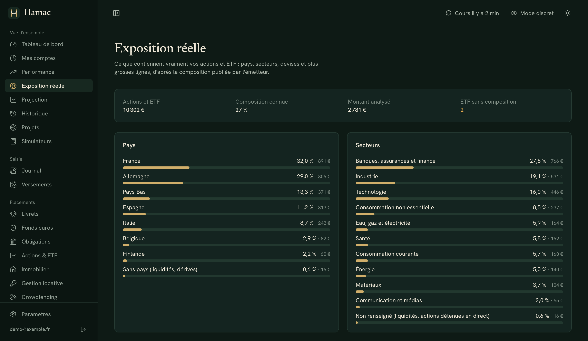
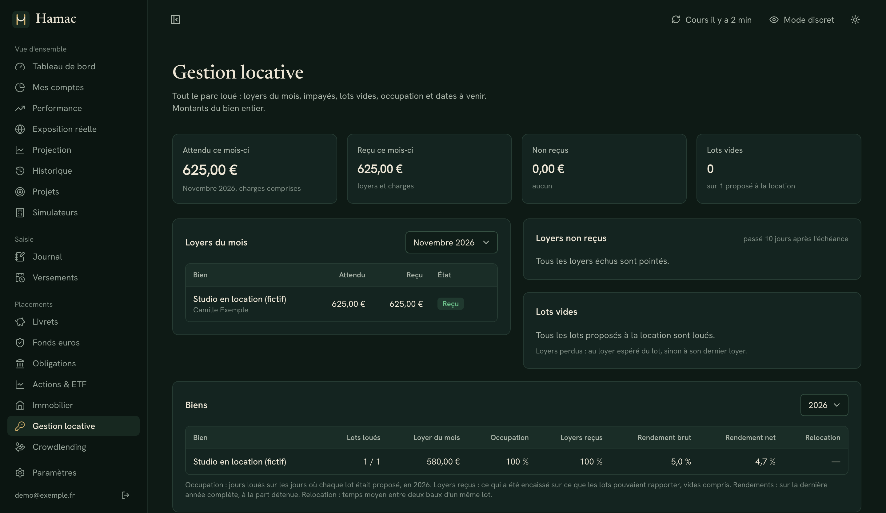
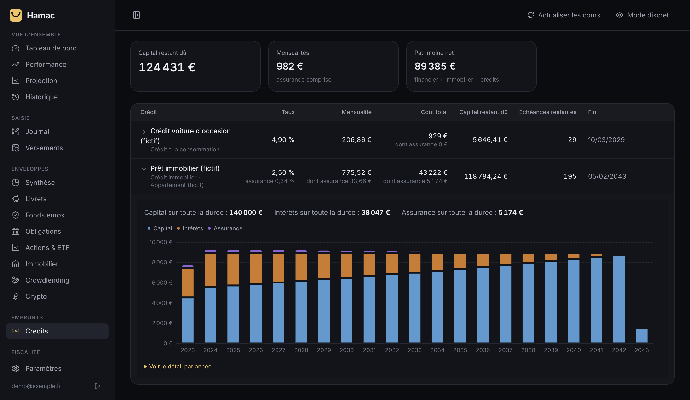
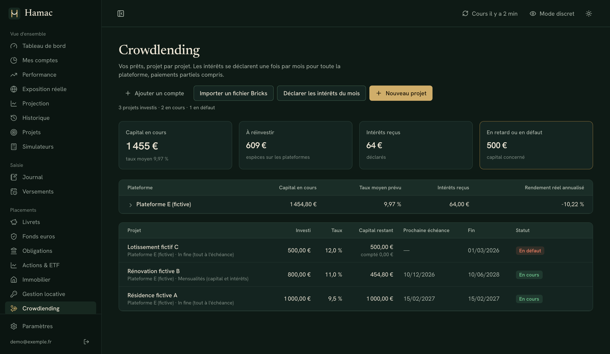
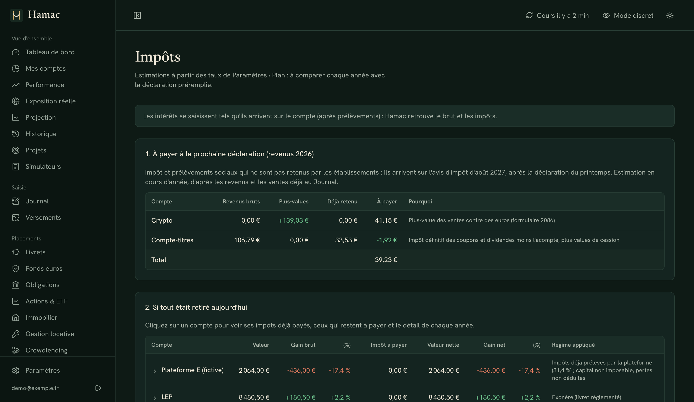
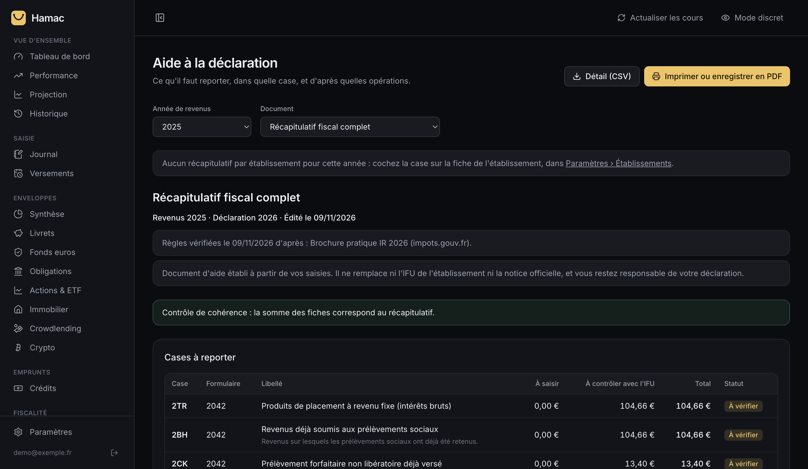
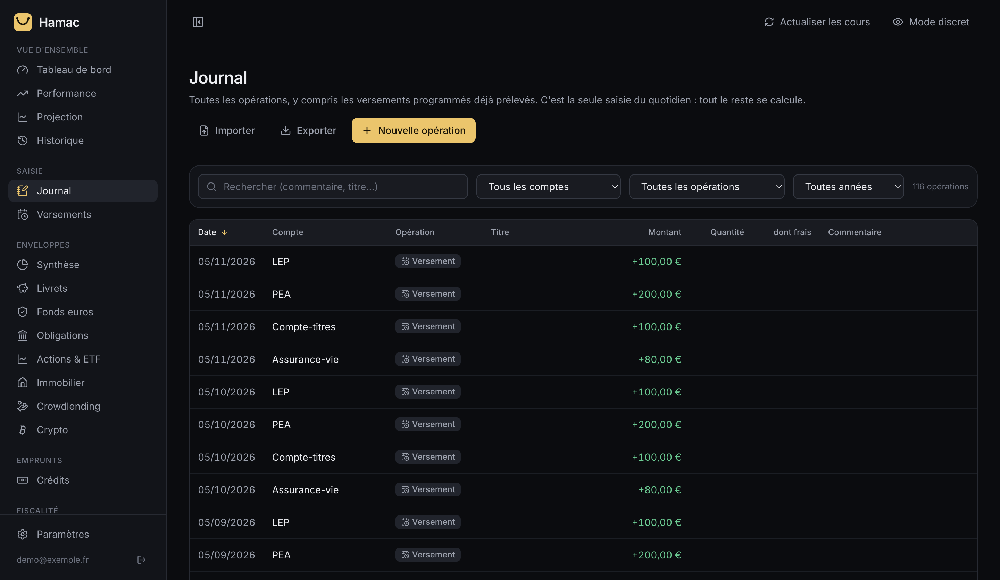

<div align="center">

# Hamac

**Suivre son patrimoine, préparer sa retraite, avec la fiscalité française.**

Livrets · assurance-vie · PEA · PER · compte-titres · obligations · crypto · crowdlending · immobilier locatif · crédits · autres biens

[](LICENSE)


<picture>
  <source media="(prefers-color-scheme: dark)" srcset="docs/captures/dashboard.png">
  <source media="(prefers-color-scheme: light)" srcset="docs/captures/dashboard-clair.png">
  
</picture>

<sub>Thème sombre « Nocturne » ou clair « Maison », au choix ou selon le système.</sub>

</div>

Hamac est un logiciel libre, à héberger soi-même, pour suivre tout son patrimoine et préparer sa retraite
sur le long terme. On y note ce qui se passe (versements, achats, intérêts, coupons) ; Hamac calcule le reste :
valeur de chaque compte, plus-values, rendement annualisé, impôts, projection jusqu'au départ et revenu
mensuel possible ensuite. Il est né d'un tableur personnel devenu trop fragile, et en reprend toute la logique
en la fiabilisant.

- **Pensé pour la France** : livrets réglementés, règle des quinzaines, assurance-vie (8 ans, abattement),
  PEA (5 ans), prélèvements sociaux, flat tax ou barème, plus-values crypto (art. 150 VH bis), aide à la déclaration.
- **Vos données restent chez vous** : une application web que vous hébergez. Aucun service tiers, sauf
  l'assistant que vous choisissez de brancher vous-même.
- **Pilotable par un assistant** : branchez Claude ou un autre assistant compatible MCP, donnez-lui vos relevés
  PDF ou CSV, il les importe après un aperçu et votre accord.
- **Pour vous et vos proches** : chaque compte a son espace isolé dans PostgreSQL ; les cours sont communs
  à l'instance, téléchargés une seule fois et tenus à jour même quand personne n'est connecté.
- **À votre mesure** : préparation de la retraite ou simple gestion de patrimoine, pages masquables, classes
  d'actifs et répartition cible personnalisables.

> Nom provisoire. Hamac est en développement actif : les fonctionnalités ci-dessous sont en place et
> testées. La version actuelle est la [0.1.0](CHANGELOG.md) : tant que le numéro commence par `0.`,
> le fonctionnement peut encore changer d'une version à l'autre.

---

## Sommaire

- [Fonctionnalités](#fonctionnalités)
- [Captures](#captures)
- [Installation](#installation)
- [Sources de données et vie privée](#sources-de-données-et-vie-privée)
- [Avertissement](#avertissement)
- [Développement](#développement)
- [Contribuer](#contribuer)
- [Feuille de route](#feuille-de-route)
- [Licence](#licence)

---

## Fonctionnalités

### Voir l'essentiel d'un coup d'œil

- **Tableau de bord** : patrimoine net, évolution par période, allocation réelle face à la cible, comptes,
  projection (ou actifs et dettes) et seulement ce qui demande une action.
- **Évolution de chaque compte et de chaque titre** : valeur totale et montant investi, avec une courbe par
  titre dans un compte. Un clic sur une ligne suffit pour voir un compte ou un titre seul.
- **Mes comptes** côte à côte, avec leur rôle, leur part du patrimoine et la garantie en cas de faillite.
- **Performance** : rendement annualisé (TRI) par enveloppe, placement ou compte, rendement cumulé hors
  versements, plus forte baisse, volatilité, et d'où vient le gain.
- **Historique** : la situation à deux dates et ce qui a changé entre les deux, reconstruit mois par mois depuis
  le journal. Corriger une opération passée corrige tout l'historique.
- **Exposition réelle** : ce que contiennent vraiment vos ETF (pays, secteurs, devises, plus grosses lignes), d'après
  la composition publiée par l'émetteur (Amundi, iShares).
- **Projets** : un achat, des études, des travaux, avec la somme à réunir, la date, les comptes affectés et le
  versement mensuel nécessaire.

### Suivre chaque placement

- **Livrets** (LEP, LDDS, Livret A…) : historique des taux, intérêts de l'année calculés par quinzaines,
  plancher et plafond du plan, plafonds légaux.
- **Assurance-vie** : fonds euros, taux servis, rapprochement avec le relevé de l'assureur, clause
  bénéficiaire, garantie FGAP.
- **Obligations** (OAT et entreprises) détenues jusqu'à l'échéance : calendrier et prochain coupon, coupon
  couru, valeur amortie, rendement actuariel, remboursement automatique, achats prévus et réalisés.
- **Actions et ETF** (PEA, PEA-PME, PER, épargne salariale, comptes-titres) : prix de revient, cours
  automatiques, écart à la répartition cible, achat conseillé du mois.
- **Crypto** : positions, plus-values de chaque cession et impôt de l'année.
- **Crowdlending** : prêts projet par projet, intérêts déclarés par mois et par plateforme, paiements
  partiels, échéances prolongées, retards et défauts, import du fichier Bricks.
- **Immobilier et SCPI** : biens, fiche descriptive et DPE, statut, frais d'achat et part détenue, pour obtenir
  le patrimoine net ; dépenses et rentabilité, résultats par année, valeur dans le temps, vente, documents et fiche
  imprimable.
- **Gestion locative** : tout le parc loué comme le suivrait une agence. Lots, baux, locataires et garanties,
  loyers du mois pointés un par un, impayés, lots vides, occupation, révision du loyer selon l'indice INSEE, et
  courriers prêts à imprimer (quittance, avis d'échéance, relance, attestation, révision).
- **Autres biens** : or, objets de valeur, véhicules, parts de société non cotée, argent prêté, avec la valeur en
  cas de vente rapide et l'impôt à la vente.
- **Crédits** immobiliers, travaux, consommation ou auto, avec différé et remboursements anticipés : échéance et capital restant dû calculés ou repris
  d'un relevé, assurance en montant fixe ou en taux (capital emprunté ou restant dû), coût année par année.

### Calculer et anticiper

- **Répartition cible** ligne par ligne : classes d'actifs personnalisables, chaque élément inclus ou non,
  rendement attendu facultatif et baisse progressive de la part d'actions à l'approche de la retraite.
- **Capacité d'épargne** répartie automatiquement entre les comptes, à appliquer en un clic.
- **Projection** année par année jusqu'au départ, avec les versements programmés, les frais des
  établissements et les grosses dépenses prévues, puis la phase de retraits jusqu'à l'âge horizon.
- **Fourchette de résultats** selon les marchés (simulation de Monte-Carlo) et simulateur « et si »
  (versement en plus, âge de départ, rendement, inflation).
- **Simulateurs** : rendement brut et net d'impôts d'un placement avant d'investir (obligation, ETF ou actions,
  fonds euros, crowdlending…), comparés côte à côte pour un même montant.
- **Impôts** : ce qu'il faudra payer à la prochaine déclaration, ce que coûterait un retrait aujourd'hui,
  rendements nets comparés, impôts de chaque année (acompte, régularisation, prélèvements sociaux).
- **Compteurs et plafonds** : ancienneté des PEA et assurances-vie, plafonds de versement, abattement annuel de
  l'assurance-vie et abattements de donation restants.
- **Aide à la déclaration** : cases à reporter par année de revenus, fiche par établissement et récapitulatif
  complet, contrôles de cohérence, comparaison avec le document reçu, export PDF et CSV. Un document d'aide, qui
  ne remplace ni l'IFU ni la notice officielle.

### Contrôler

- **Alertes** : livrets hors fourchette, répartition qui s'écarte de sa cible, espèces à investir,
  échéance proche, cours manquants, ordres trop chers, intérêts de l'année à saisir, anniversaires
  fiscaux, clause bénéficiaire à rédiger…
- **Établissements** : chaque banque, courtier, assureur ou plateforme avec ses grilles de frais (courtage
  par paliers, droits de garde, frais sur versements et de gestion), et un comparatif calculé.

### Saisir simplement

- **Journal unique** de toutes les opérations, et **versements mensuels programmés** par compte, avec les
  mois manqués.
- Formulaires guidés : prix par unité ou montant total (l'autre se calcule), frais d'après la grille de
  l'établissement, titres créés au moment de l'achat, obligations saisies par leur coupon et leur échéance.
- **Recherche de titres** par nom ou par ISIN (actions, ETF, obligations d'État et d'entreprise, crypto).
- **Import des relevés** de banque ou de courtier en CSV, OFX ou QIF (aperçu avant import, doublons repérés) et export CSV.
- **Sauvegarde complète** exportable et restaurable, pour passer d'une instance à une autre.
- Barre latérale réductible, tableaux triables, mode discret qui masque les montants, thème clair ou sombre,
  modules à afficher ou masquer.

### Confier la saisie à un assistant (MCP)

Hamac embarque également un serveur [MCP](https://modelcontextprotocol.io) (*Model Context Protocol*). Claude Code, Claude
Desktop ou tout autre assistant compatible peut s'y brancher avec un jeton d'accès créé dans Paramètres › Application.

- **Importer n'importe quel relevé** : PDF d'un assureur, avis d'opéré, export CSV, OFX ou QIF, capture d'écran.
  L'assistant lit le document ; Hamac compare chaque ligne au journal, signale les doublons, les versements déjà
  programmés et les lignes invalides, et n'écrit rien avant votre accord. Un import se défait pendant 24 heures.
- **Interroger son patrimoine** : « combien ai-je versé sur mon PER depuis 2023 ? », « quelle plus-value latente sur
  le PEA ? ». Les chiffres sont ceux que calcule Hamac, avec les mêmes règles que les écrans.
- **Vérifier ses données** : encours d'un relevé de situation comparé à l'encours calculé, et contrôles de Hamac
  (incohérences du journal, cours en échec, écarts à la cible).
- **Accès maîtrisé** : jeton en lecture seule ou en lecture et import, avec une durée limitée et révocable à tout
  moment. Seule son empreinte est stockée.

```bash
claude mcp add --transport http hamac https://votre-hamac.exemple.fr/api/mcp --header "Authorization: Bearer hamac_…"
```

La commande exacte s'affiche à la création du jeton. Détails dans le [guide des assistants](docs/assistants-mcp/guide.md).

## Captures

<table>
  <tr>
    <td width="50%"></td>
    <td width="50%"></td>
  </tr>
  <tr>
    <td align="center">Mes comptes côte à côte</td>
    <td align="center">Performance et origine du gain</td>
  </tr>
  <tr>
    <td width="50%"></td>
    <td width="50%"></td>
  </tr>
  <tr>
    <td align="center">Projection et simulateur « et si »</td>
    <td align="center">Exposition réelle des ETF</td>
  </tr>
  <tr>
    <td width="50%"></td>
    <td width="50%"></td>
  </tr>
  <tr>
    <td align="center">Historique reconstruit depuis le journal</td>
    <td align="center">Gestion locative</td>
  </tr>
  <tr>
    <td width="50%"></td>
    <td width="50%"></td>
  </tr>
  <tr>
    <td align="center">Crédits et capital restant dû</td>
    <td align="center">Obligations gardées jusqu'à l'échéance</td>
  </tr>
  <tr>
    <td width="50%"></td>
    <td width="50%"></td>
  </tr>
  <tr>
    <td align="center">Crowdlending, projet par projet</td>
    <td align="center">Impôts de l'année et en cas de retrait</td>
  </tr>
  <tr>
    <td width="50%"></td>
    <td width="50%"></td>
  </tr>
  <tr>
    <td align="center">Aide à la déclaration</td>
    <td align="center">Journal des opérations</td>
  </tr>
</table>

Les captures utilisent uniquement le jeu de démonstration, entièrement fictif.

## Installation

Il faut [Docker](https://www.docker.com) avec Docker Compose, rien d'autre.

```bash
git clone https://github.com/maxxroot/hamac-finance.git hamac
cd hamac
docker compose up -d --build
```

Ouvrez <http://localhost:8080> et créez le premier compte, avec le code d'installation à usage unique affiché
par `docker compose logs hamac`. Ce compte devient administrateur de l'instance et règle les sources de cours.
Les suivants s'inscrivent ensuite avec un code d'invitation. Chacun peut changer son mot de passe dans
Paramètres › Application.

```bash
docker compose exec hamac node cli.mjs invite              # code d'invitation à transmettre
docker compose exec hamac node cli.mjs users               # liste des comptes
docker compose exec hamac node cli.mjs password <e-mail>   # réinitialiser un mot de passe
docker compose exec hamac node cli.mjs 2fa-reset <e-mail>  # désactiver la double authentification d'un compte
```

Par défaut, Hamac n'écoute que sur la machine qui l'héberge. Hors de cette machine, il refuse les connexions
en HTTP simple.

**Mise en production, en HTTPS** : faites pointer un nom de domaine vers le serveur, ouvrez les ports 80 et 443,
puis décommentez `COMPOSE_FILE` et `HAMAC_DOMAIN` dans `.env` (`cp .env.example .env`) et lancez
`docker compose up -d --build`. [Caddy](https://caddyserver.com) obtient et renouvelle le certificat, redirige
le HTTP vers HTTPS, et Hamac n'est plus joignable que par lui.

Toutes les variables se règlent dans ce fichier `.env`, facultatif, exclu de git et de l'image Docker.

| Variable | Défaut | Rôle |
|---|---|---|
| `HAMAC_DOMAIN` | | Nom de domaine servi par Caddy, avec `COMPOSE_FILE` |
| `HAMAC_BIND` | `127.0.0.1` | `0.0.0.0` pour écouter sur le réseau, derrière votre propre reverse proxy HTTPS |
| `HAMAC_TRUST_PROXY` | `0` | `1` derrière un reverse proxy : HTTPS détecté, vraie adresse des visiteurs. Réglé par le Caddy fourni |
| `HAMAC_SECURE` | `0` | `1` pour considérer toute requête comme HTTPS. Réglé par le Caddy fourni |
| `HAMAC_ALLOW_HTTP` | `0` | `1` pour autoriser le HTTP simple hors de la machine (déconseillé) |
| `HAMAC_SIGNUP` | `invite` | `invite`, `open` ou `closed` |
| `HAMAC_DB_PASSWORD` | `hamac` | Mot de passe PostgreSQL, lettres et chiffres ; la base n'est jamais exposée hors de Docker |
| `HAMAC_MEMORY` | `0` | Mémoire maximale du conteneur de l'application (`512m`, `1g`…), `0` pour aucune limite. 512m au minimum |
| `HAMAC_DB_MEMORY` | `0` | Mémoire maximale du conteneur PostgreSQL, `0` pour aucune limite. 256m au minimum |
| `HAMAC_PORT` | `8080` | Port publié sur la machine |
| `HAMAC_SESSION_DAYS` | `30` | Durée d'une session avant de devoir se reconnecter |
| `HAMAC_PRICES` | `1` | `0` pour ne pas actualiser les cours automatiquement, ni remettre à jour chaque trimestre les compositions d'ETF (elles le sont alors à l'ouverture de la page Exposition réelle) |
| `HAMAC_REFRESH_MINUTES` | `30` | Minutes entre deux actualisations des cours, 10 au minimum ; le quota de Twelve Data peut ralentir ce rythme |
| `HAMAC_TWELVEDATA_KEY` | vide | Clé [Twelve Data](https://twelvedata.com), facultative. C'est le seul endroit où elle se règle : ni en base, ni dans l'interface |
| `HAMAC_TWELVEDATA_DAILY_LIMIT` | `800` | Requêtes par jour de votre offre Twelve Data |
| `HAMAC_2FA_KEY` | vide | Clé de la double authentification (32 octets, `openssl rand -base64 32`). Vide : fichier `2fa.key` créé dans `/data` au premier lancement. À sauvegarder avec la base |
| `HAMAC_MCP` | `1` | `0` pour couper les assistants sur toute l'instance : plus de route `/api/mcp` ni de jeton d'accès |

**Sécurité** : mots de passe hachés avec Argon2id, sessions par cookie `HttpOnly`, `SameSite=Strict` et `Secure`
en HTTPS, HSTS, en-tête anti-CSRF, limitation des tentatives de connexion et de la taille des requêtes, en-têtes
CSP et anti-iframe, code d'installation à usage unique, conteneurs sans privilèges. Chaque compte a son propre
schéma et son propre rôle PostgreSQL : il ne peut lire ni les données des autres ni les comptes de l'instance.

**Jetons d'accès des assistants** : créés depuis une session ouverte, avec le mot de passe, et affichés une seule
fois. Seule leur empreinte est stockée. Chacun est limité à un compte, en lecture ou en écriture, et expire au bout
de 30 jours à 1 an. Ils passent dans l'en-tête `Authorization`, jamais dans un cookie, et sont limités à 120 requêtes
par minute. Changer de mot de passe, activer la double authentification ou la faire réinitialiser les révoque tous.

**Double authentification** : facultative, à activer dans Paramètres › Application, avec une application de codes
(TOTP, RFC 6238). Un code déjà accepté ne ressert pas. Le secret de chaque compte est chiffré en AES-256-GCM, les
10 codes de secours sont à usage unique et seule leur empreinte est stockée. Le QR code est calculé dans le navigateur.

La clé qui protège tout cela est dans `HAMAC_2FA_KEY` ou, par défaut, dans le fichier `2fa.key` du volume `hamac-data`.
**Sauvegardez-la avec la base, mais à part de celle-ci** (`docker compose cp hamac:/data/2fa.key ./2fa.key`) : sans
elle, les comptes protégés ne peuvent plus se connecter. Hamac ne plante pas : il l'indique dans ses journaux et à la
connexion, et les comptes sans double authentification continuent de fonctionner.

Une personne a perdu son téléphone et ses codes de secours, ou la clé est perdue :
`docker compose exec hamac node cli.mjs 2fa-reset <e-mail>` désactive la protection de ce compte et ferme ses sessions.

Avant chaque migration de la base, une copie de chaque compte est écrite dans le volume `hamac-data`, en JSON
compressé. Chaque personne peut exporter et restaurer ses données dans Paramètres › Application. Ce volume est
sur la même machine que la base : pour vous protéger d'une panne de disque, copiez aussi la base ailleurs
(par exemple `docker compose exec -T db pg_dump -U hamac hamac > hamac.sql`).

**Reprendre une ancienne base de l'application de bureau** : avec Node.js 22.13 ou plus récent,
`node apps/server/scripts/export-desktop.mjs` crée `hamac-export-bureau.json`, à restaurer dans
Paramètres › Application. Le dernier état du bureau reste disponible au tag `derniere-version-desktop`.

## Sources de données et vie privée

Hamac ne collecte rien et n'envoie vos données nulle part. Les seules requêtes vers l'extérieur servent
à récupérer des cours et à identifier des titres, sans clé d'API par défaut. Les cours sont actualisés
toutes les 30 minutes pour toute l'instance ; l'ordre des sources se règle dans Paramètres › Cours.

| Source | Utilisation |
|---|---|
| [justETF](https://www.justetf.com) | Cours et historique des ETF, par ISIN |
| [Euronext](https://live.euronext.com) | Actions et ETF cotés en euros, par ISIN |
| [Twelve Data](https://twelvedata.com) | Par symbole, avec votre clé ; l'offre gratuite ne couvre que le marché américain |
| Yahoo Finance | Dernier recours, au mieux : l'accès peut être refusé selon le réseau |
| [CoinGecko](https://www.coingecko.com) | Cours et historique des cryptos |
| [OpenFIGI](https://www.openfigi.com) | Recherche et identification des titres (obligations comprises) |

Ces requêtes révèlent aux fournisseurs les identifiants des titres que vous suivez, pas leurs montants.

**Assistants (MCP)** : si vous branchez un assistant, ce qu'il lit dans Hamac (comptes, opérations, montants) part
chez le fournisseur du modèle, comme tout ce que vous écrivez dans la conversation. C'est votre choix : sans jeton
créé par vous, aucun assistant n'a accès à rien, et l'administrateur peut couper la fonction pour toute l'instance.
Les obligations n'ont besoin d'aucun cours (valeur calculée). Tout cours peut être saisi à la main, et un titre
peut imposer sa source ou une adresse personnalisée.
Les accès non officiels peuvent cesser de fonctionner sans préavis ; respectez les conditions
d'utilisation de chaque fournisseur.

## Avertissement

Hamac est un outil de suivi et de calcul, **pas un conseil en investissement**. Les projections reposent
sur des hypothèses que vous choisissez et ne garantissent aucun résultat. Les règles fiscales et les taux
par défaut sont ceux de 2026 et doivent être vérifiés chaque année (avis d'imposition, déclaration
préremplie, impots.gouv.fr). En cas de doute sur votre situation, consultez un professionnel.

## Développement

Hamac est écrit entièrement en TypeScript, en monorepo pnpm :

```
apps/
  server/     serveur web (Hono) : comptes, tenants, interface, serveur MCP des assistants
packages/
  core/       calculs métier purs : fiscalité, frais, obligations, projection, alertes (sans dépendance d'E/S)
  api/        contrat typé (zod) entre l'interface et le backend
  backend/    PostgreSQL + Drizzle, tenants isolés, migrations embarquées, base de cours commune
  ui/         interface React
  architecture/  tests de structure : frontières entre couches et domaines, liens de la documentation
```

L'interface ne connaît que le contrat `@hamac/api`, qu'elle appelle en HTTP. Les calculs vivent dans
`@hamac/core` et tournent dans le navigateur, ce qui rend les simulations instantanées. Le serveur MCP
(`apps/server/src/mcp/`) passe par le même contrat et appelle le même moteur ([décision 0009](docs/decisions/0009-serveur-mcp-et-jetons-d-acces.md)).

```bash
pnpm dev:db         # PostgreSQL dans Docker, exposé en local (à lancer une fois)
pnpm dev            # serveur sur :8080 et interface avec rechargement à chaud sur http://localhost:5173
pnpm test           # tests (Vitest), sur un PostgreSQL en mémoire (PGlite) : Docker non requis
pnpm typecheck      # vérification des types de tous les paquets
pnpm build          # interface et serveur, dans apps/server/dist
HAMAC_LIVE=1 pnpm test   # inclut les tests sur les vraies sources de cours
```

**Modifier le schéma de la base** : éditer la table dans `packages/backend/src/db/schema/<domaine>.ts` puis lancer
`pnpm --filter @hamac/backend db:generate`, qui crée la migration SQL et l'embarque dans le code. Elle
s'applique à chaque tenant à sa prochaine ouverture. Une reprise de données s'écrit à la main dans le
fichier SQL généré.

La documentation est dans [`docs/`](docs/README.md) : un guide et une documentation technique par
fonctionnalité, [l'organisation du code](docs/architecture/organisation-du-code.md) (où va un nouveau
fichier), [le modèle de données](docs/architecture/modele-de-donnees.md) et [les décisions](docs/decisions/README.md).
Les frontières entre couches et domaines sont vérifiées par `pnpm test` ([détail](docs/frontieres-du-code/technique.md)).

## Contribuer

Les contributions sont bienvenues : signalements, idées, corrections, nouvelles fonctionnalités.

- **Un bug, une idée** : ouvrez une issue en décrivant ce que vous attendiez et ce qui s'est passé. Pour
  un calcul, un exemple chiffré aide beaucoup. Ne joignez jamais vos vraies données : reproduisez le cas
  avec le jeu de démonstration ou des montants fictifs.
- **Une modification** : ouvrez une pull request avec des tests. Toute règle de calcul ou de fiscalité
  va dans `@hamac/core`, accompagnée de tests chiffrés, et cite sa source (texte de loi, BOFiP, site
  officiel).
- **Langue** : l'interface, les messages et la documentation sont en français.
- **Documentation** : une fonctionnalité nouvelle ou modifiée met à jour son `docs/<sujet>/guide.md` et son
  `technique.md` dans la même pull request.
- **Avant d'envoyer** : `pnpm typecheck` et `pnpm test` doivent passer.
- **Une faille de sécurité** : ne la signalez pas dans une issue publique ; suivez [SECURITY.md](SECURITY.md).

## Feuille de route

- Première version publiée
- Affichage adapté au téléphone et installation en application (PWA)
- Alertes par bots Discord, Telegram et Matrix
- Journal des connexions et vérification de l'e-mail, pour une instance ouverte au public
- Modèles d'établissements pré-remplis (grilles de frais datées, à vérifier)
- Formats d'import CSV prêts à l'emploi pour les principaux courtiers
- Assistants (MCP) : saisie de l'immobilier, de la gestion locative et des crédits ; connecteurs claude.ai (OAuth)
- Mémorisation des tris et des filtres

## Licence

Hamac est distribué sous licence [GNU AGPL v3](LICENSE). Vous pouvez l'utiliser, l'étudier, le modifier
et le redistribuer librement. Toute version modifiée mise à disposition d'autres personnes, y compris
via un serveur, doit publier son code source sous la même licence.
